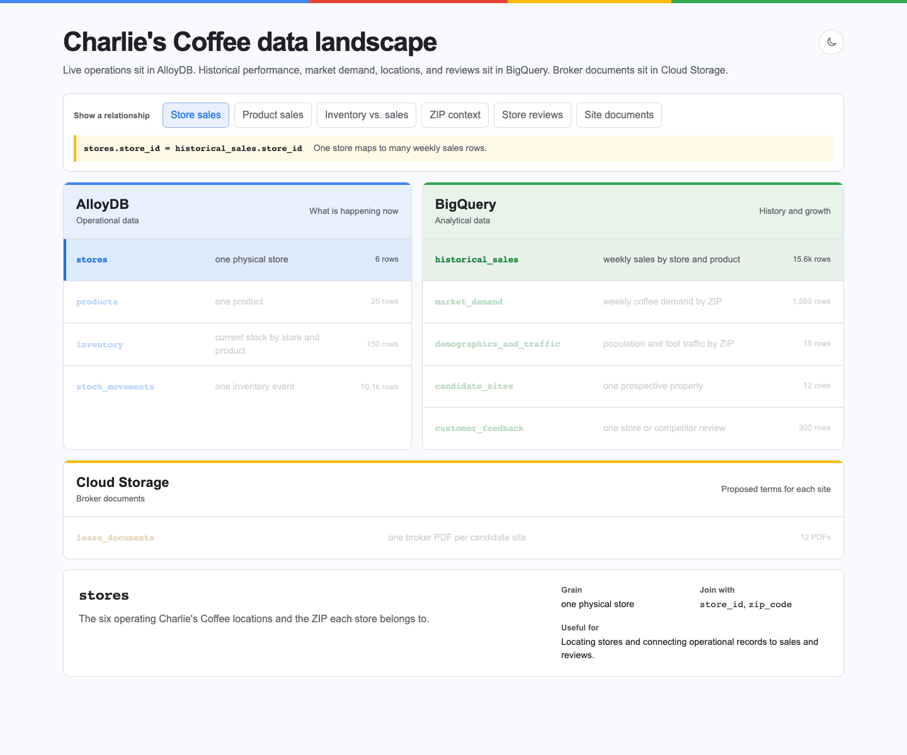

# Data Cloud Creator Workshop

A hands-on workshop using AI coding agents and Google Cloud data tools to explore
a coffee shop expansion scenario.

Prepare your computer a few days before the workshop. Your Skills/Qwiklabs lab
will provide the Google Cloud project and access instructions on workshop day;
you do not need to create a personal Cloud project, billing account, or free trial.
Afterward, you can [recreate the workshop in your own project](#after-the-workshop-use-your-own-project-optional).

## Before the workshop: check your computer

Install these prerequisites using their official instructions:

- [Git](https://git-scm.com/downloads)
- [Google Cloud CLI](https://cloud.google.com/sdk/docs/install)
- [Node.js 22.6 or newer and npm](https://nodejs.org/en/download) (current LTS recommended)
- One supported agent: [Codex CLI](https://developers.openai.com/codex/cli/),
  [Claude Code CLI](https://code.claude.com/docs/en/setup), or
  [Antigravity CLI](https://www.antigravity.google/docs/cli/install/)

Clone the repository:

```bash
git clone https://github.com/jeffonelson/data-cloud-creator-workshop.git
cd data-cloud-creator-workshop
```

Then check local prerequisites:

```bash
./bin/doctor --preflight
```

This checks command availability and the minimum Node.js version. It makes no
cloud requests, starts no login flow, and installs or configures nothing. No
Google sign-in, project, or credit card is required. Fix any reported failures
using the installation links and rerun until there are zero failures.

A passing preflight confirms local prerequisites only. Agent sign-in, Google
authentication, project permissions, plugins, and live tools are checked later.

## Workshop day: connect your assigned project

### 1. Sign in for the lab

Follow the lab's instructions to obtain your assigned project ID and the identity
to use. Authenticate as that identity; replace `YOUR_LAB_PROJECT_ID` below with
the assigned project ID:

```bash
gcloud auth login --project=YOUR_LAB_PROJECT_ID
gcloud auth application-default login --project=YOUR_LAB_PROJECT_ID
```

Sign in to your chosen agent CLI if needed: `codex login`, `claude auth login`,
or `agy`. Agent sign-in is separate from Google Cloud sign-in. Workshop resources
are prepared by the organizers; skip provisioning for your assigned lab project.

### 2. Configure and verify

`./bin/setup` checks access to your project and secrets, then installs
and configures the newest Data Agent Kit release for each supported agent on
your computer. It uses upstream DAK setup to select BigQuery, AlloyDB and Cloud Storage, with
notebook and visualization tools included by upstream. The plugin is
`dak@dak-marketplace`; the data servers are `dak-bigquery` and `dak-alloydb`.
Restart open agent sessions after setup.

Use the project ID and region supplied by your Skills lab. Skills can prefill
both values in the setup command. Setup saves them for subsequent launches.
BigQuery uses its own dataset location; Cloud Run follows the selected region.

The selected project is saved in ignored `.workshop-state/project.env` and upstream's
non-secret `~/.config/data-agent-kit/config.json`. Setup does not change the global
gcloud project. A conflicting pre-existing DAK config or plugin installation stops
setup; resolve it with upstream DAK or the agent's plugin commands, then retry.
To move an installation owned by this checkout to a later release, run
`./bin/teardown` and then `./bin/setup PROJECT_ID --region REGION` again. Pre-existing installations are preserved.

```bash
./bin/setup YOUR_LAB_PROJECT_ID --region YOUR_LAB_REGION
```

`./bin/doctor` runs read-only checks for the required software, agent CLI login,
Google Cloud authentication, plugin installation, and MCP configuration.

```bash
./bin/doctor
```

Existing checkouts must rerun setup with --region once. Doctor verifies cluster
access in that region and checks that the agents' settings agree.

### 3. Launch one agent

Use a workshop launcher instead of running `codex`, `claude`, or `agy` directly so it
can load the workshop credentials and project settings before starting the agent.

```bash
./bin/workshop-codex
```

```bash
./bin/workshop-claude
```

```bash
./bin/workshop-antigravity
```

Trust the repository when prompted. Keep this session open for the entire lab.

## After the workshop: use your own project (optional)

To continue after the lab expires, use an existing billing-enabled project you
own. Install Python 3 and Google Cloud CLI with `bq`, then sign in with your own
Google account and replace `YOUR_PROJECT_ID`:

```bash
gcloud auth login --project=YOUR_PROJECT_ID
gcloud auth application-default login --project=YOUR_PROJECT_ID
./bin/provision YOUR_PROJECT_ID
./bin/setup YOUR_PROJECT_ID --region us-central1
./bin/doctor
```

Allow about 15–20 minutes, then launch an agent as above. Provisioning creates
billable resources, including AlloyDB, which keeps charging until removed.
`./bin/teardown` removes local setup only.

## Connectivity check

First, run `/mcp` in the agent and confirm that the Developer Knowledge, Maps
Grounding Lite, Cloud Run, BigQuery, AlloyDB, and Cloud Storage MCP servers are loaded.
Cloud Storage comes from the Data Agent Kit and uses your Google Cloud credentials.

Then paste the following prompt into the same agent session and run it:

```text
Use the MCP tools for these checks. Make one successful read-only call to each service:

1. Developer Knowledge: retrieve the official BigQuery row-level security documentation.
2. Maps: find two coffee shops near Golden Gate Park and include their Google Maps links.
3. BigQuery: list datasets in the workshop project.
4. AlloyDB: list clusters in the configured workshop region.
5. Cloud Storage: list the objects under leases/ in the workshop project's
   PROJECT_ID-charlies-documents bucket. Confirm there are 12 PDFs.

Use the project selected during setup, replacing PROJECT_ID with that ID.
Return a five-row PASS/FAIL table. Empty BigQuery or AlloyDB results count as
PASS; missing lease PDFs need organizer attention.
```

## Data landscape

[](https://jeffonelson.github.io/data-cloud-creator-workshop/data-landscape.html)

[Open the interactive data landscape](https://jeffonelson.github.io/data-cloud-creator-workshop/data-landscape.html)
to explore the tables, documents, and relationships between them.

The broker's documents are available in
`gs://PROJECT_ID-charlies-documents/leases/`, one PDF per `candidate_sites.site_id`.
Use your setup-selected project ID. The documents are available throughout the lab.
Developer Knowledge provides official Google Cloud documentation; Maps Grounding
Lite supplies current place and route context with Google Maps attribution.

## Charlie's expansion scenario

> **🎯 Your north star**
>
> Recommend Charlie’s next San Francisco location and be prepared to defend it. The prompts below are suggestions, not a required sequence. Ask your own questions and follow whichever evidence interests you.

Charlie's Coffee operates six San Francisco stores and is choosing where to open
next. Run the suggested prompts for the shortest path through the scenario, then
choose any optional follow-ups that match your interests and available time.
Continue in the same agent session so later prompts can build on earlier findings.

The suggested path uses **Developer Knowledge → business data → a shortlist →
Google Maps → broker documents**. Record your recommendation before the
facilitator calls the room together. These are fictional business records; Maps
provides real-world context around the scenario's representative locations.

### Frame the decision

#### Suggested prompt

```text
Use the Developer Knowledge MCP to explain why Charlie's might keep live
inventory in AlloyDB, sales and market history in BigQuery, and broker PDFs in
Cloud Storage. Cite official Google Cloud documentation. How can an agent
bring these sources together to help choose a location?
```

#### Optional follow-ups

```text
How can we analyze AlloyDB and BigQuery together without first building another ETL pipeline? Use the official Google Cloud documentation and cite the documents you use.
```

```text
Charlie's wants to open a seventh San Francisco store. Help me make a recommendation we can defend. Before running any analysis, what evidence would you want, and where would you expect to find it?
```

### Investigate unmet demand

#### Suggested prompt

```text
Where is Charlie's inventory failing to meet customer demand?
```

#### Optional follow-ups

```text
Can stock-movement history explain how those shortages developed?
```

### Check the customer evidence

#### Suggested prompt

```text
Use BigQuery AI to extract availability complaints from customer reviews.
Do they corroborate the live inventory?
```

#### Optional follow-ups

```text
Can you combine the operational and analytical evidence in one analysis without copying the AlloyDB data into BigQuery first?
```

```text
Which complaints match specific store/product pairs, and which are ambiguous?
```

### Choose a new location

#### Suggested prompt

```text
Use BigQuery AI.FORECAST to forecast six months of candidate-market demand.
Recommend one site and one runner-up after estimating store revenue and
accounting for asking rent. Explain how market demand becomes store revenue.
Label the result as a comparison, not profit: other operating costs are missing.
```

#### Optional follow-ups

```text
What separates Charlie's strongest store markets from its weakest ones?
```

```text
How did you translate market demand into store revenue? Check your assumptions
against Charlie's existing stores.
```

```text
What assumptions have the most influence on the ranking, and what would need to change for the runner-up to win?
```

Write down this first recommendation and its main assumption. Then test it with
Maps and the broker documents below.

### Test the recommendation in the real world

#### Suggested prompt

```text
Use Maps Grounding Lite to compare the surroundings of my recommended SF site
and runner-up. What nearby places strengthen or weaken each case? Include
every returned Google Maps source link immediately after the claim it supports
and preserve its attribution. Distinguish observed places from assumptions
about their effect on sales.
```

#### Optional follow-ups

```text
Does nearby coffee competition indicate saturation, or does it validate demand?
```

```text
Which nearby residential areas could expand Charlie’s delivery reach through DoorDash or Uber Eats? Use Maps to compare driving times from the site.
```

```text
Which nearby residential buildings and neighborhood anchors are within a 10-minute walk of the site and could contribute launch-day foot traffic?
```

### Check the broker's documents

Before settling on your recommendation, give both finalists a document check.
The broker has supplied one draft per candidate site in Cloud Storage. If you
already explored them, use this step to audit your comparison.

#### Suggested prompt

```text
Use Cloud Storage MCP to read the broker PDFs for my recommended site and
runner-up in gs://PROJECT_ID-charlies-documents/leases/. Use my setup-selected
project ID and match the documents to candidate_sites by site_id.

Check our rent assumptions against the proposed terms. Compare monthly base
rent, other recurring property charges, and the length of the commitment.
Cite the document, page and section for each finding. Separate stated amounts,
estimates and unknowns. Does this change your recommendation or confidence?
```

#### Optional follow-up

```text
Audit the revised comparison. Are the amounts monthly or annual? Did we count
anything twice? Keep refundable deposits separate from recurring expenses.
What would we need the broker to confirm before making a commitment?
```

If PDF reading fails, tell the facilitator and run `./bin/doctor`; a successful
listing alone does not prove the agent can read a PDF. The exported checkout
also contains the identical files in `data/seed/leases/` for a clearly identified
local fallback. Do not invent terms or treat missing costs as zero.

> **⏸️ Facilitator checkpoint**
>
> Record your current choice, runner-up, one reason supported by a source, and
> one assumption that could change your mind. Continue exploring until the
> facilitator calls the room back together.

## Further exploration

The remaining activities are for extra workshop time or continued exploration afterward.

### Make it local

Want to explore somewhere you know? Bring Charlie's to your own spot. Replace
`[LOCATION]` with anywhere in the world you'd like to explore; include the country
if the name could be ambiguous. San Francisco's numbers remain business benchmarks.
Skip this section to continue with your San Francisco recommendation.

#### Suggested prompt

```text
What if Charlie's expanded into [LOCATION]? Use Maps to suggest three areas
worth exploring, informed by what we learned from its San Francisco stores.
```

#### Follow-up

```text
Which area looks most promising, and what would we need to verify?
Pick a specific map anchor for a hypothetical store to explore next.
```

### Plan the launch

#### Suggested prompt

```text
Design a launch-week plan for the recommended site using everything we have learned.
```

#### Optional follow-ups

```text
If we held an outdoor launch event at the recommended site this weekend, what do the hourly and daily weather forecasts suggest, and how should we adjust the plan?
```

```text
Which nearby gyms and coworking spaces should we approach as launch partners?
```

```text
What stock problems should we avoid repeating at launch?
```

```text
Revise the launch plan based on what you discovered.
```

### Visualize and share (optional)

#### Suggested prompt

```text
Build an interactive BI dashboard that helps our team explore Charlie's sales,
inventory, and market demand. Highlight the most interesting findings.
```

#### Optional follow-ups

```text
Audit the dashboard's numbers and labels against the source data.
```

```text
Deploy the dashboard to Cloud Run so our team can revisit it. Return the live URL.
```


## Uninstall

Exit the agent, then run:

```bash
./bin/teardown
```

This removes workshop-installed agent plugins and local workshop state. It does
not change Google Cloud or delete this repository.

## Disclaimer

This is a project intended for demonstration and workshop purposes only. It is
not intended for use in a production environment. This repository is not an
officially supported Google product.
